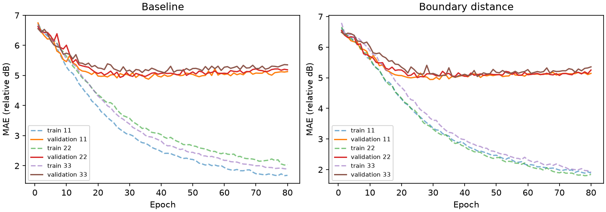
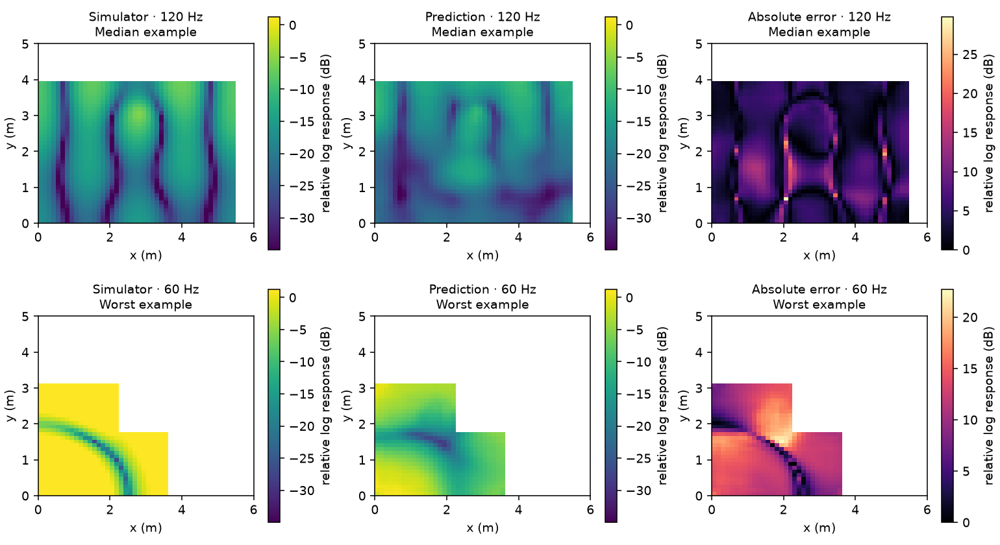
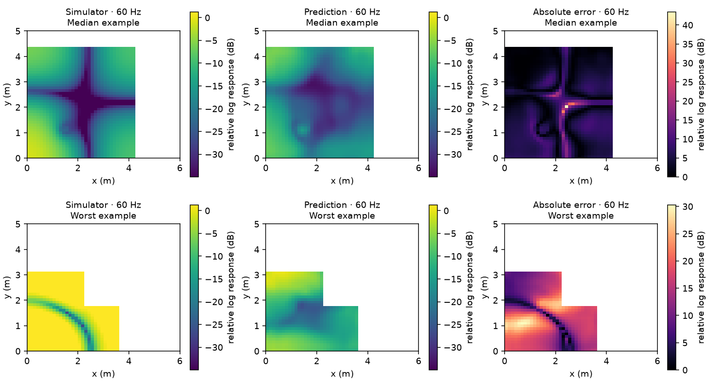
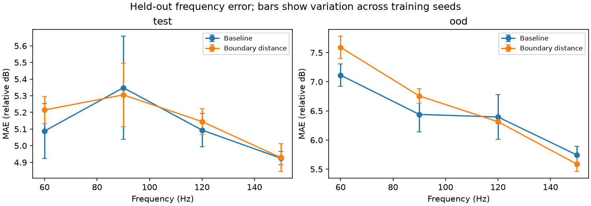

# Where should I put my speaker?

This project trains a deep learning model to map the sound levels in a 2D room. This is then used to predict the best spot to put a speaker given the dimensions of the room and position of listeners. The performance of the model is compared to a numerical solver. We then tried to improve the performance of the model by giving it boundary distance information. 

The numerical model and deep learning model and details of the experiment are explained below. 

You can try the interactive app here:

## Numerical model
You can think of the numerical model as finding the repeating pressure pattern the room can sustain while the speaker keeps driving it. It achieves this using the *inhomogeneous Helmholtz equation*:

\[
\nabla^2 p + k^2(1+i\eta)p = -s,
\qquad
k=\frac{2\pi f}{c}.
\]
Where:
\(p\)	= Pressure response at each location
\(\nabla^2p\) = How pressure curves across space
\(s\) = Speaker source
\(f\)	= Frequency
\(c\)	= speed of sound (343 m/s)
\(\eta\)	= Damping factor (0.04)

We divide the room into 48 x 48 grid cells. The spatial curvature for each cell  is approximated using neighbouring cells instead of calculating pressure at infinitely many points. 
We represent the speaker as a small Gaussian “bump” centred at its position.

The spatial-curvature term becomes:
\[
\nabla^2p \approx
\frac{p_E-2p_C+p_W}{dx^2}
+
\frac{p_N-2p_C+p_S}{dy^2}.
\]
Collecting the cell equations gives:
\[
A\mathbf p=\mathbf b.
\]
- \(A\) contains the room connections, frequency, spacing and damping.
- \(\mathbf p\) contains the unknown pressures.
- \(\mathbf b\) contains the speaker source.
The matrix is sparse: each cell directly connects to at most four neighbours and itself.

SciPy is then used to solve this system simultaneously. For a fixed room and frequency, moving the speaker changes only \(\mathbf b\). We can therefore reuse the expensive factorisation of \(A\), which makes testing many positions fast.

The pressure has a complex value so we calculate its amplitude \[
|p|\]
 and convert it  into a logarithmic response.  That produces the heatmap.  The neural network we train learns to approximate the numerical heatmaps from the room, speaker position and frequency. 
 
 ## Deep Learning Model

Two versions of a small U-Net were trained to predict the bass response heatmap produced by the numerical solver. Basicall they answer the question: given a room, speaker position and frequency what response magnitude should we expect at every location? 

The input to the model is a  stack of 48 x 48 maps with the following input channels:
1. Room mask: Which cells contain air and which are outside the room.
2. Speaker source map:	Where the speaker is, represented by the same normalised Gaussian used in the solver.
3. Frequency map: The selected frequency, divided by 150 Hz and repeated across the grid.
4. Wall-distance map: Each air cell’s approximate distance to the nearest wall, scaled by the fixed canvas size.

The `baseline model` recieves only the first 3 channel while the `boundary model `recieves all four. Both models were trained to help determine if giving the network an explicit geometric feature helps it learn more effectively than receiving the room mask alone. 

The network predicts amplitude information as in the numeric solver. 

The loss was mean absolute error (MAE) inside the room:
\[
\text{loss}
=
\operatorname{mean}_{\text{examples}}
\left[
\operatorname{mean}_{\text{air cells}}
|\text{prediction}-\text{target}|
\right].
\]
where the target is the solver generated heat map. 

The baseline model has 487,297 parameters while the boundary model has 487,441 parameters. 

## Dataset generation
The rooms were randomly generated. Each room has a 6 x 5 m dimension and divided into 48 x 48 grid. The width of the the room is sampled between 3.5 and 6m and the height between 3 and 5m making a mixture of rectangles and  L-shaped rooms. An L-shape was created by removing a rectangular corner from the upper-right. For ordinary rooms, an L-shaped cutout occupied 20–45% of the room’s width and height. For the out of distribution test set used deeper cutouts of 55–72%. That creates a deliberate generalisation challenge: unfamiliar proportions, rather than just new examples of familiar proportions.

Four distinct grid cell centres (with a 0.20m from walls constraint) were randomly selected for each room as the speaker positions. For each speaker position the Helmholtz equation was then solved at 60, 90, 120, and 150 Hz frequencies producing 16 response fields per room. 

The training set consists of 160 rooms, validstion set had 20 rooms, test set has 20 rooms and then an out of distribution test set consisting of unfamiliar rooms shapes contained another 20 rooms. 

Room masks were hashed to reject duplicates across splits. 

Both models use the same splits, batch ordering seeds, width, training steps, AdamW settings and checkpoint selection criterion (validation MAE). Different first-layer shapes mean their initial weights are not numerically identical. A frequency conditioned median predictor is fitted using training data as a simple constant-field baseline.


## Results and Findings

These results are from the full experiment. Both models were trained for 80 epochs using three random seeds (11, 22 and 33). The values below are averaged across the three runs. Errors are measured against the numerical solver in relative log response units (dB), rather than real world sound pressure measurements.

### Did the model learn?

#### Training Loss curves

The training loss continued to decrease for both models, but the validation loss started to level off which suggests overfitting. The checkpoints with the lowest validation MAE between epochs 25 and 41 were selected for evaluation. 



Both models performed better than the constant-field predictor on unseen rooms. This predictor gives every cell the same response level for a given frequency, so it does not capture any spatial patterns.

| Model | Test MAE | Out of distribution MAE |
|---|---:|---:|
| Constant-field predictor | 6.71 | 7.32 |
| Baseline model | 5.11 | 6.42 |
| Boundary model | 5.15 | 6.56 |

Both models learned some of the response patterns, although there is still a substantial difference between their predictions and the numerical solution.

#### Field examples

The predictions capture some of the broad wave patterns and regions of stronger and weaker response. However, they tend to smooth out narrow cancellation regions and can predict the wrong overall response level.

For each model, the first row below shows a median error test example and the second shows its worst example. 

Baseline model:



Boundary model:



### Does wall distance information help?

Giving the model wall distance information did not improve its average prediction error in this experiment. Seems the room mask already gives the baseline model boundary information. On the ordinary test rooms, the difference was small: 5.15 dB for the boundary model compared to 5.11 dB for the baseline. The paired confidence interval included zero, so this does not establish a difference between the models.

On unfamiliar L-shaped rooms, the boundary model performed slightly worse in all three runs. Its average error increased by 0.14 dB relative to the baseline, with a 95% room bootstrap confidence interval of 0.04 to 0.24 dB. 

### Speaker placement prediction

For each held-out room, we defined five listening points along a sofa and generated 20 new valid speaker positions. Both models scored the same positions over the four frequencies. The score penalised variation across the listening points and weak overall response.

Every candidate was also evaluated using the numerical solver. We compared the model's choice to random placement, a fixed corner oriented choice and the best candidate according to the solver. The gap between the solver score of the model's choice and the best candidate is called regret. Lower regret is better, and zero means the model selected the best of those 20 candidates.

| Model | Test regret | Out of distribution regret |
|---|---:|---:|
| Baseline model | 1.32 | 1.12 |
| Boundary model | 1.24 | 1.13 |

Both models improved over random placement on average, but neither consistently selected the best candidate. The difference in regret between the two models was inconclusive: the paired confidence intervals included zero for both test groups. These values are placement-score units, rather than distances between speaker positions.

### Does it generalise well?

Both models performed better on rooms within the training shape ranges than on unfamiliar rooms with deeper cutouts. The baseline also performed better on ordinary rectangular rooms (4.83 dB MAE) than ordinary L-shaped rooms (5.34 dB MAE).

Performance depended on frequency. On the unfamiliar rooms, the largest average errors were at 60 Hz: 7.11 dB for the baseline and 7.59 dB for the boundary model. The boundary model had lower errors at 120 and 150 Hz, but this did not offset its higher errors at 60 and 90 Hz.



The models can approximate some acoustic patterns in unseen rooms, but the errors increase when the geometry moves outside the training range. The worst examples show that a reasonable average error does not guarantee a good prediction for an individual room and speaker position. 

The full measurements and comparisons are saved in the [experiment report](reports/full/REPORT.md).


## What next?

Some ideas I'd like to explore:

- Improve the current U-Net. Training shows overfitting, so try fewer parameters, stronger regularisation and some hyperparameter tuning, guided by related work.
- Test physical inductive biases, such as reflection symmetry or a Helmholtz loss using complex pressure predictions.
- Compare the U-Net with a small Fourier Neural Operator using the same data and training budget.
- Gradually add internal obstacles and different wall absorption, before considering a 3D model of a furnished room.

## Run locally

Python 3.10 or newer and [uv](https://docs.astral.sh/uv/) are required. The lockfile fixes dependency versions; CPU is the default training device.

```sh
uv sync --extra dev
uv run pytest -q
uv run bass-spot validate
uv run bass-spot run --config configs/pilot.json --data data/pilot --output runs/pilot
uv run streamlit run app.py
```

The app also works before training: choose **Simulator only**. After training, choose a checkpoint in the sidebar to compare fields and request a placement. Search evaluates all candidates with the simulator and displays the recommendation's regret relative to the best of those candidates. Moving a speaker or changing the room/listening region clears the displayed recommendation.

To run the full training:

```sh
uv run bass-spot run --config configs/full.json --data data/full --output runs/full
```

Individual stages can be run independently:

```sh
uv run bass-spot generate --config configs/full.json --data data/full
uv run bass-spot train --config configs/full.json --data data/full --output runs/full/baseline_11 --seed 11
uv run bass-spot train --config configs/full.json --data data/full --output runs/full/boundary_11 --seed 11 --boundary
uv run bass-spot evaluate --data data/full --checkpoint runs/full/baseline_11/best.pt --output runs/full/baseline_11/evaluation
uv run bass-spot evaluate --data data/full --checkpoint runs/full/boundary_11/best.pt --output runs/full/boundary_11/evaluation
uv run bass-spot compare --runs runs/full
```

Repeat the individual training/evaluation commands for seeds 22 and 33, or use `run` to execute all seeds. The `run` command retrains models; dataset generation resumes completed room shards. Change the output/data directory when changing configurations. Use `--device cuda` where supported; deterministic CPU runs are the tested reference. Hardware and library differences can change results.

On Apple Silicon, add `--device mps` to train on the Mac GPU. Metal pooling gradients are not bitwise deterministic; this backend keeps the fixed seeds, enables warnings for those operations and records `deterministic_warn_only=true` in each run. Every epoch also writes `progress.json` with current losses and elapsed time. Evaluation and placement timings use CPU inference by default.

After a complete paired study, export the measurements, figures and a readable report:

```sh
uv run python scripts/summarize_study.py --runs runs/full --output reports/full
```

## What is implemented

| Module | Responsibility |
|---|---|
| `config.py` | Physical settings, experimental settings and config fingerprints |
| `geometry.py` | Cell-centred masks, connected rooms, source maps and boundary distance |
| `solver.py` | Sparse damped Helmholtz system and reusable LU factorisations |
| `validation.py` | Analytical modes, grid refinement, damping checks and geometry gallery |
| `data.py` | Deterministic room splits, resumable shards and input tensors |
| `models.py` | Small U-Net and checkpoint-backed batched inference |
| `train.py` | Masked supervised training and validation-only model selection |
| `evaluate.py` | Held-out metrics, figures, room-bootstrap intervals and paired comparisons |
| `optimize.py` | Feasible candidates, listening-area scoring and simulator verification |
| `cli.py` | Reproducible commands |
| `app.py` | Streamlit interface |
 

## Focused references

- [PhysicsX: How a Fourier Neural Operator Learns to Solve PDEs](https://www.physicsx.ai/newsroom/how-a-fourier-neural-operator-learns-to-solve-pdes----and-where-it-falls-short): solution fields, learned operators and geometry context.
- [SciPy `spsolve`](https://docs.scipy.org/doc/scipy/reference/generated/scipy.sparse.linalg.spsolve.html) and [`splu`](https://docs.scipy.org/doc/scipy/reference/generated/scipy.sparse.linalg.splu.html): sparse systems and reusable numerical factorisations.
- [Multiscale model reduction of finite-difference frequency-domain wave modelling in acoustic media](https://academic.oup.com/gji/article/235/2/1021/7222372): Section 2.1 for the acoustic Helmholtz equation; this project uses a simpler stencil and does not reproduce the multiscale method.
- [SciPy distance transform](https://docs.scipy.org/doc/scipy/reference/generated/scipy.ndimage.distance_transform_edt.html): physical sampling for distance features.
- [Streamlit caching](https://docs.streamlit.io/develop/concepts/architecture/caching): cached data and model resources.
