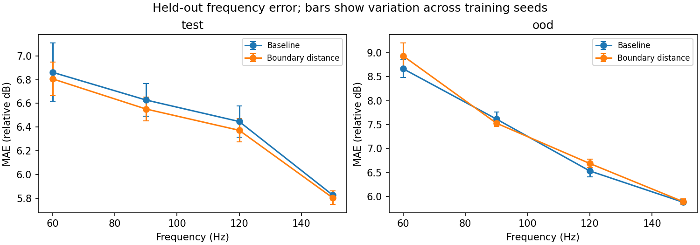
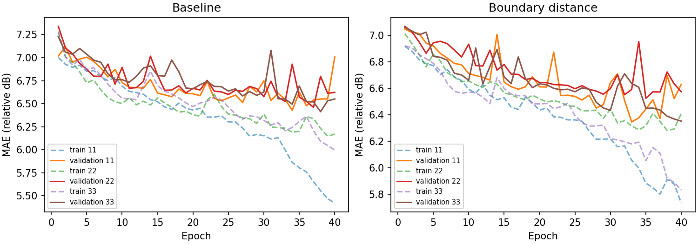
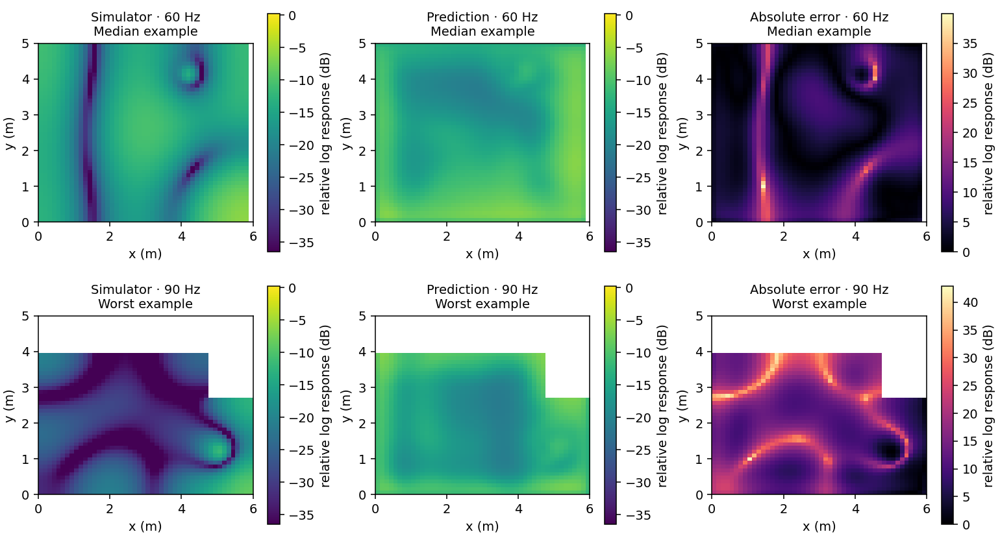
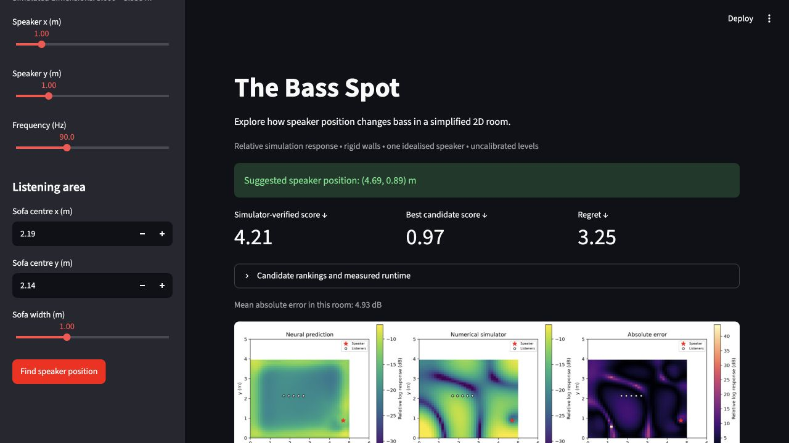

# The Bass Spot: implementation and pilot findings

The complete pipeline is implemented and exercised: validated numerical simulation, reproducible room splits, six trained U-Nets, field evaluation, speaker-placement ranking, simulator verification and a working Streamlit app.

The pilot supports a modest improvement over a constant-field predictor. It does not establish that the boundary-distance channel improves out-of-distribution prediction or placement quality. The numerical solver remains the stronger practical choice at this resolution.

## Completed experiments

The pilot contains 42 distinct rooms: 24 training, 6 validation, 6 in-distribution test and 6 deeper-cutout L-shaped test rooms. Four source positions and four frequencies yield 672 fields. Each model was trained for 40 epochs with width 8, using seeds 11, 22 and 33. Checkpoints were selected using validation error only.

The larger width-16, 80-epoch study on the full 220-room, 3,520-field dataset has now completed; see the [larger-study report](full/REPORT.md). The following results describe the earlier pilot only.

## Solver checks

The linear-system relative residual is 1.18 × 10⁻¹⁴. The largest relative frequency error over the first nine nonzero rectangular modes is 0.231%. Grid refinement from 48 × 48 to 96 × 96 gives relative complex-field errors of 0.35% for the rectangular fixture and 1.93% for the L-shaped fixture at 73 Hz, excluding a 0.4 m source neighbourhood.

Checks at all four selected bass frequencies also pass; the largest fixture refinement error is 5.64%, for the L-shaped room at 120 Hz. These checks validate specific fixtures, rather than guaranteeing equal accuracy for every geometry or resonance. Symmetry, reciprocity, source normalisation, no-flux wall handling and direct/factorised solve agreement are covered by tests.

[Validation measurements](validation/validation.json) · [Resonance sweep](validation/resonances.png) · [Geometry gallery](validation/geometry_gallery.png)

## Held-out field prediction

Values below average the three training seeds. MAE uses valid room cells in relative log-response units (dB), not calibrated SPL.

| Model | In-distribution MAE | Near-wall MAE | OOD MAE | OOD near-wall MAE |
|---|---:|---:|---:|---:|
| Frequency-conditioned constant | 6.794 | — | 7.456 | — |
| Baseline U-Net | 6.441 | 6.252 | 7.174 | 7.061 |
| Boundary-distance U-Net | 6.384 | 6.169 | 7.262 | 7.133 |

Every trained seed beats the constant predictor on both test groups. The boundary model reduces in-distribution error by 0.057 dB on average, but its paired room-bootstrap 95% interval is [-0.128, 0.012] dB. For OOD rooms it increases error by 0.087 dB, with interval [-0.026, 0.172] dB. Both intervals include zero. Only six held-out rooms support each comparison; these intervals average across the available seeds and do not fully capture training uncertainty.

There is no evidence here for a reliable generalisation gain from boundary distance. Its extra first-layer parameters are a further confound for any very small positive effect. A parameter-matched zero-channel control would be appropriate before attributing a small gain specifically to geometry information.





The field plots expose a more serious limitation than the average error suggests: predictions are smooth and often miss narrow cancellation patterns. The worst in-distribution case for boundary seed 33 is a 90 Hz L-shaped room with 14.96 dB mean error. Its response level and spatial pattern are both poorly predicted. The selected checkpoint remains better than the constant predictor on average, but it is not a reliable substitute for simulation for individual configurations.



## Placement quality

Each held-out room gets 20 new candidate source positions and five sofa listening points. Candidates exclude the original dataset source positions, remain clear of walls and stay at least 0.5 m from listeners. All model/seed runs receive identical candidates for each room. The score penalises spatial variation and mean response below -35 in the fixed relative units, averaged over four frequencies.

| Model | ID regret | OOD regret | ID improvement over random | OOD improvement over random |
|---|---:|---:|---:|---:|
| Baseline U-Net | 1.385 | 1.368 | 0.078 | 0.240 |
| Boundary-distance U-Net | 1.903 | 1.466 | -0.440 | 0.143 |

Regret is the simulator score of the model's chosen position minus the best simulator score among the same candidates; lower is better. Improvement over random compares the model choice with the expected simulator score of a uniformly random candidate; positive is better. These are objective-score units, not physical placement-distance errors.

The boundary model's small in-distribution field-error reduction does not translate into better placement. It performs worse than random choice on average for these six ID rooms. This is why ranking quality needs its own evaluation. The app displays simulator-verified regret rather than implying the neural recommendation is optimal.

## Runtime and reproducibility

For the baseline model, mean candidate-search CPU times are approximately:

| Workload | Cold solver | Warm solver | Warm neural prediction |
|---|---:|---:|---:|
| In-distribution rooms | 32.4 ms | 13.1 ms | 74.1 ms |
| OOD rooms | 17.9 ms | 8.5 ms | 71.8 ms |

Cold solver timing includes assembly and LU factorisation. Warm solver timing reuses factors and batches source right-hand sides. Neural timing includes input preprocessing after warmup. These are local measurements with background system load, not performance guarantees. The neural surrogate provides no acceleration here. The six pilot training runs total approximately 511 seconds, excluding data loading and evaluation.

The pilot was generated and trained with Python 3.12.0, NumPy 1.26.4, SciPy 1.14.1 and PyTorch 2.7.0 on CPU with two Torch threads. [Pilot runtime metadata](pilot/runtime.json) records the actual environment. The application and tests were additionally verified under the newer dependency environment recorded in [tested_environment.json](tested_environment.json); its dependency versions are captured by the root `uv.lock`. Re-running training under different numerical libraries or hardware can change results even with the same seeds.

[Per-seed result table](pilot/RESULTS.md) · [Paired comparisons](pilot/comparison.json) · [Dataset counts](datasets.json)

## Using the implementation

From the repository root:

```sh
uv sync --extra dev
uv run pytest -q
uv run streamlit run app.py
```

Choose a trained checkpoint in the sidebar. The existing pilot checkpoints are in `runs/pilot`; generated datasets and checkpoints are excluded from Git. The saved measurements and figures in this report remain part of the source deliverables.

To reproduce the pilot or run the larger experiment, use the commands in the root README. The next scientific step is the larger controlled experiment, followed by a parameter-matched ablation if a small boundary-feature benefit persists. FNOs, transformers and real-room claims remain outside this implementation.


