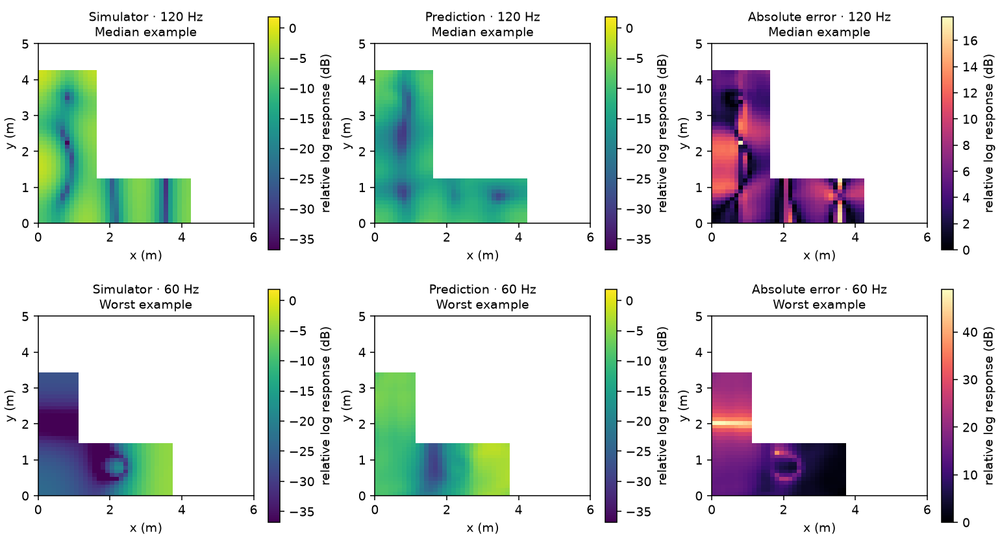

# Larger training study

Completed six models on 220 rooms and 3,520 simulated fields: 160 training, 20 validation, 20 in-distribution test and 20 OOD test rooms. Both models use width 16, 80 epochs, and paired seeds [11, 22, 33].

Checkpoints were selected by validation MAE. Test data did not determine training settings or stopping.

## Findings

Adding wall distance worsened average prediction error on unfamiliar L-shaped rooms. The paired room-bootstrap interval excludes zero in favour of the baseline.
The baseline U-Net beats the training-derived constant predictor in both test groups, but retains substantial field error.
Neither test group establishes a placement-regret difference between the models.
The cached numerical solver is faster than baseline neural inference on CPU for this 48 × 48 workload. These timings do not measure GPU inference.

## Field prediction

Lower is better; values average the three training seeds. Units are relative log response (dB), not calibrated sound-pressure levels.

| Model | Split | MAE | Near-wall MAE | Interior MAE | Constant MAE |
|---|---|---:|---:|---:|---:|
| baseline | test | 5.114 | 5.122 | 5.113 | 6.706 |
| baseline | ood | 6.424 | 6.289 | 6.524 | 7.316 |
| boundary | test | 5.149 | 5.189 | 5.134 | 6.706 |
| boundary | ood | 6.563 | 6.434 | 6.656 | 7.316 |

## Paired comparisons

Differences are averaged across seeds within each room, then bootstrapped over rooms. Negative values favour boundary distance. These intervals condition on the available training runs; they do not fully capture training uncertainty. Per-seed differences are saved in summary.json.

- **test, mae:** boundary − baseline = 0.035; 95% room-bootstrap interval [-0.0217, 0.0899]. This does not establish a difference; the interval includes zero.
- **test, near_wall_mae:** boundary − baseline = 0.067; 95% room-bootstrap interval [0.0003, 0.1322]. This favours the baseline on these held-out rooms.
- **test, regret:** boundary − baseline = -0.080; 95% room-bootstrap interval [-0.3636, 0.2053]. This does not establish a difference; the interval includes zero.
- **ood, mae:** boundary − baseline = 0.139; 95% room-bootstrap interval [0.0375, 0.2405]. This favours the baseline on these held-out rooms.
- **ood, near_wall_mae:** boundary − baseline = 0.145; 95% room-bootstrap interval [0.0563, 0.2356]. This favours the baseline on these held-out rooms.
- **ood, regret:** boundary − baseline = 0.015; 95% room-bootstrap interval [-0.1969, 0.2225]. This does not establish a difference; the interval includes zero.

The boundary input adds a small number of first-layer parameters. A positive result would still need a parameter-matched control before attributing it solely to wall distance.

## Placement

Every held-out room uses 20 identical candidates across models/seeds, excluding the original dataset source positions. Regret measures the simulator score gap to the best of those candidates. Positive improvement over random is better; lower regret is better.

| Model | Split | Regret | Improvement over random | Mean rank correlation |
|---|---|---:|---:|---:|
| baseline | test | 1.323 | 0.254 | 0.172 |
| baseline | ood | 1.115 | 0.880 | 0.216 |
| boundary | test | 1.243 | 0.334 | 0.218 |
| boundary | ood | 1.131 | 0.864 | 0.308 |

## CPU inference timing

GPU training does not imply GPU inference: these inference measurements use two CPU threads. Cold solver includes assembly/factorisation; warm solver reuses LU factors. Neural timing includes input preparation after warmup. Timings are local measurements, not performance guarantees.

| Model | Split | Cold solver (ms) | Warm solver (ms) | Neural (ms) |
|---|---|---:|---:|---:|
| baseline | test | 28.1 | 11.2 | 146.8 |
| baseline | ood | 16.3 | 7.7 | 146.2 |
| boundary | test | 26.2 | 11.2 | 165.8 |
| boundary | ood | 17.3 | 8.4 | 162.7 |

## Training and provenance

Total measured training time: 55.9 minutes. Training devices: mps. Library versions and device settings are recorded in every training.json.

Metal requires nondeterministic pooling-gradient operations. Seeds are fixed and this limitation is recorded as deterministic_warn_only=true; bitwise reproducibility is not claimed.

- baseline_11: best epoch 36, 9.1 minutes, 487,297 parameters
- baseline_22: best epoch 27, 9.4 minutes, 487,297 parameters
- baseline_33: best epoch 41, 9.3 minutes, 487,297 parameters
- boundary_11: best epoch 29, 9.4 minutes, 487,441 parameters
- boundary_22: best epoch 25, 9.3 minutes, 487,441 parameters
- boundary_33: best epoch 37, 9.4 minutes, 487,441 parameters

## Field examples

The displayed seed for each model is selected using validation error, not test error. Each figure shows its median-error and worst-error test examples with shared response colour scales.

## Scope

The larger study changes training-room count, network width, training budget, library versions and device relative to the pilot; held-out rooms also differ. Comparisons with the pilot are descriptive and do not isolate the effect of additional training data. The controlled comparison here is baseline versus boundary distance within this larger study.

The model remains a 2D, four-frequency, rigid-wall simulation with fixed damping and an idealised source. It is not a calibrated predictor for real rooms. No PDE residual is computed from magnitude-only predictions.

[Raw per-seed results](RESULTS.md) · [Summary measurements](summary.json) · [Experiment provenance](experiment.json) · [Solver checks](validation/validation.json)
